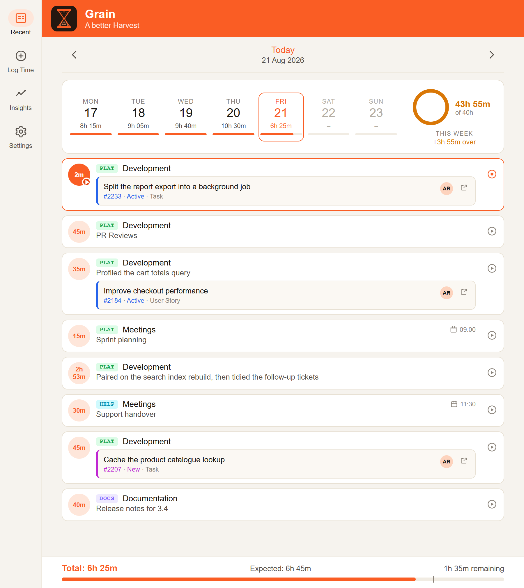
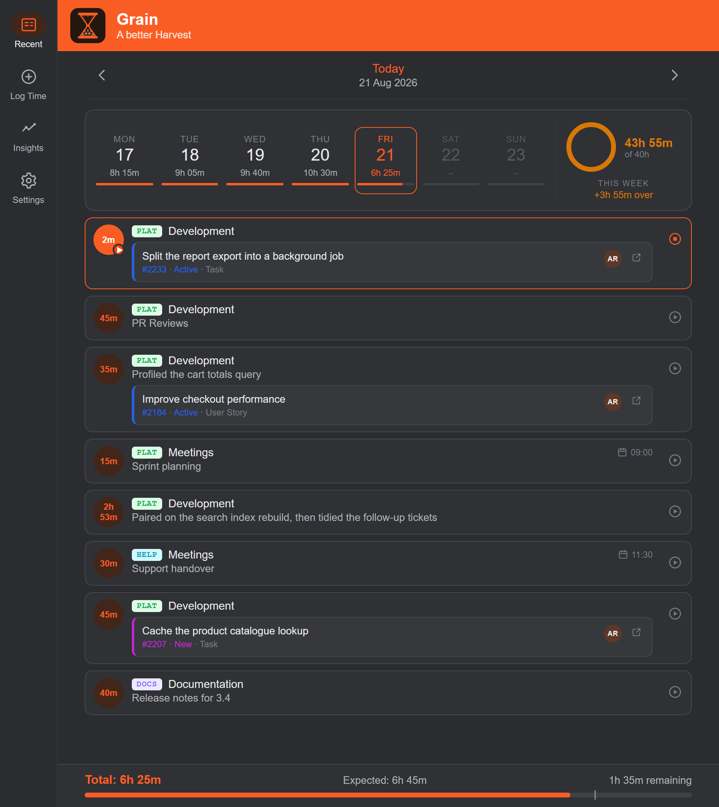
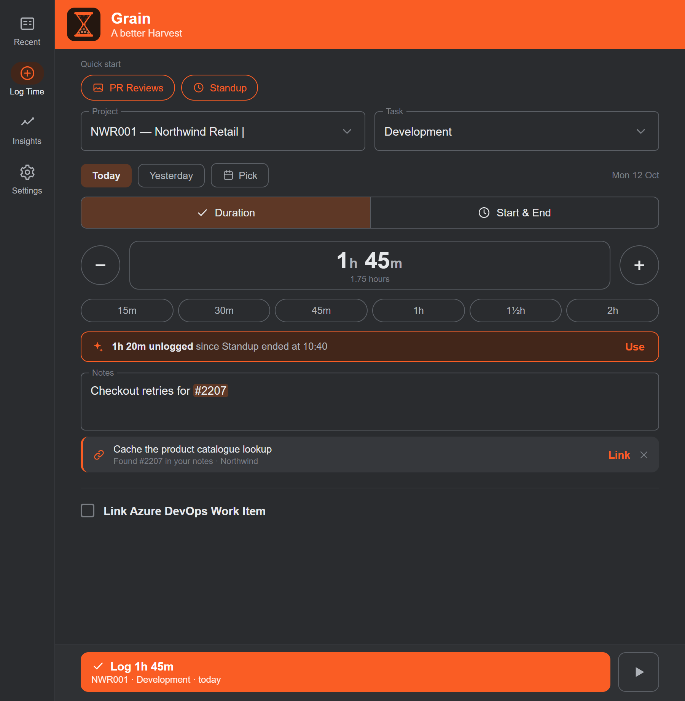
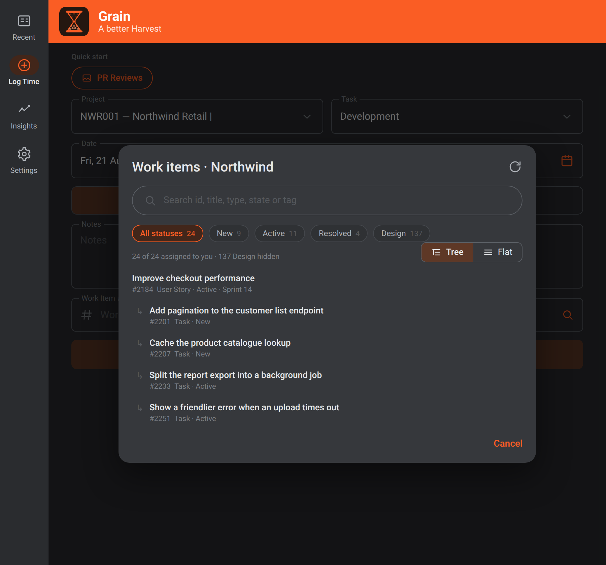
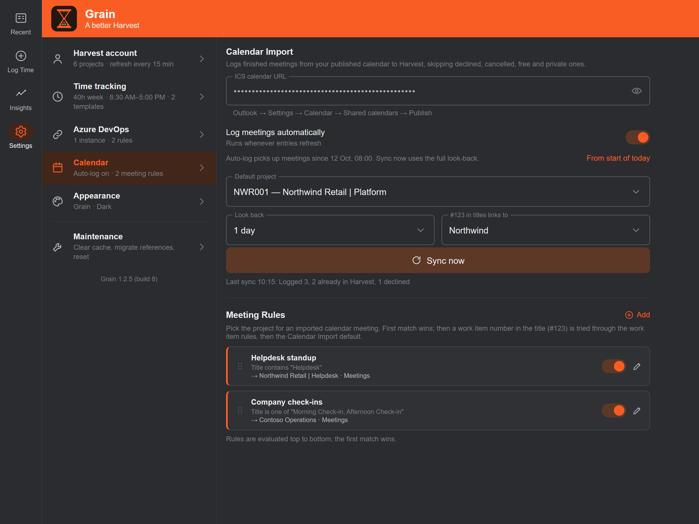
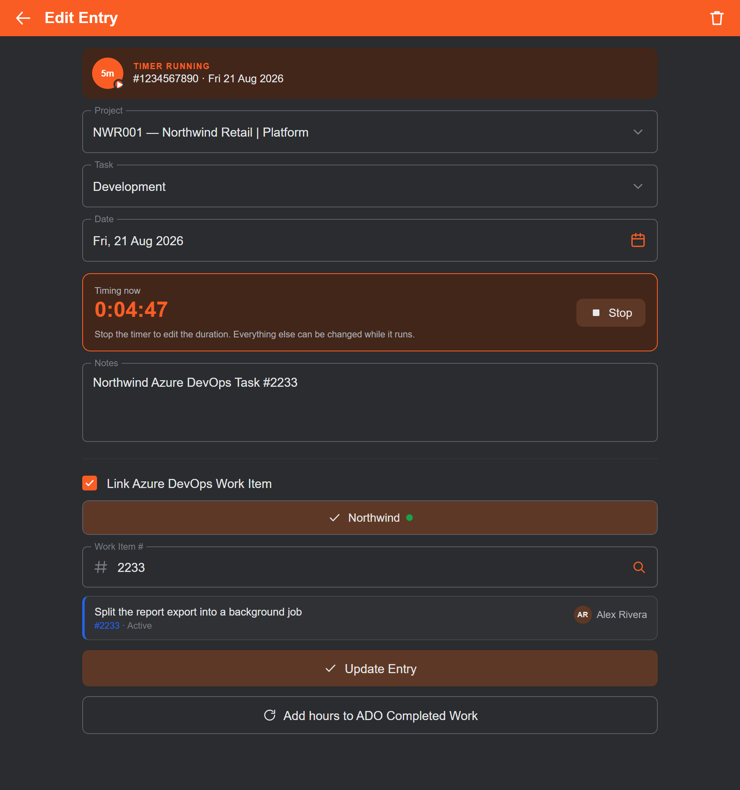
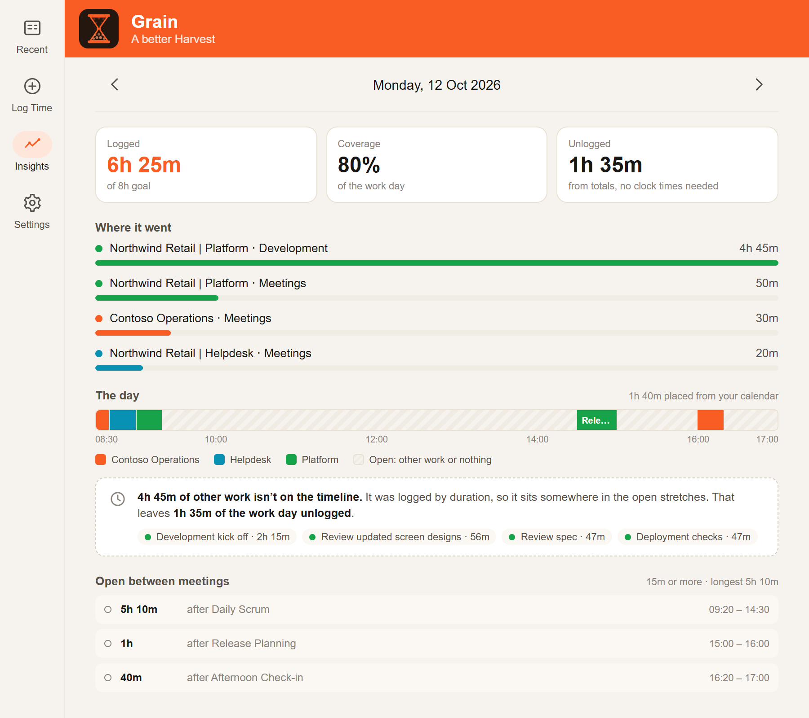
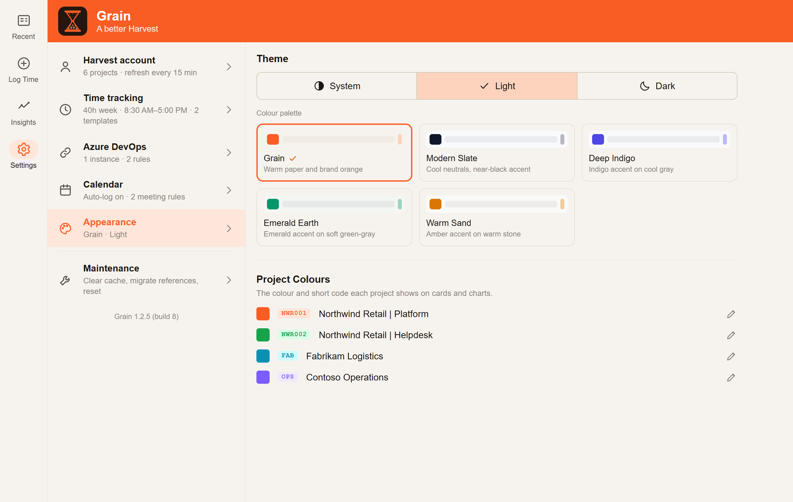
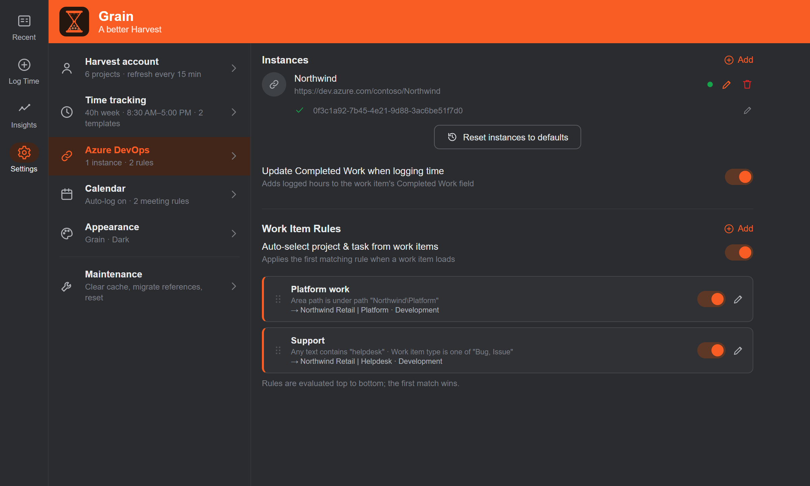

# Grain
### A better Harvest

A personal Flutter app for logging time entries to [Harvest](https://www.getharvest.com/) with first-class Azure DevOps integration and automatic logging of your Outlook meetings. Runs as a **web app** and an **Android APK**.

| Light                                                | Dark                                               |
| ---------------------------------------------------- | -------------------------------------------------- |
|  |  |

> The screenshots are rendered mockups, not captures of a live account — the
> sources live in [`docs/mockups/`](docs/mockups/) and the projects, work items
> and people in them are invented. See [Regenerating the
> screenshots](#regenerating-the-screenshots).

## Features

### Log Time



The duration stepper at 1h 45m, the unlogged gap since the last entry, a
`#2207` in the notes offering to link the work item, and the pinned bar that
says exactly what will be sent.

- **Project & task selection** — loads your assigned projects and tasks from the Harvest API; responsive layout places the two dropdowns side-by-side on wide screens
- **Default project & task** — configure defaults in Settings → Time tracking so the form is pre-filled on load
- **Duration stepper** — `−` / `+` in 5-minute steps (hold to repeat), quick chips for 15m–2h, or tap the number and type `1:45`, `1.75`, `1h 45m` or `105m` (a bare whole number is minutes). Starts at zero rather than guessing 1h
- **Fill the gap** — on today, offers the time since your last timed entry ended ("1h 20m unlogged since Standup ended at 10:40") with one tap to use it
- **Duration or Start & End** — log a plain duration, or start and end times that default to where your last entry ended and to now, with ±5 nudges; when your Harvest account tracks time by clock times, those are sent through and power the Insights gap analysis. The mode you pick is remembered
- **Pinned Log button** — always on screen, and it reads what will be sent: "Log 1h 45m · NWR001 · Development · today"
- **Today / Yesterday / Pick** — date chips instead of a date field
- **Work item spotting** — a `#123` or `AB#123` typed into the notes offers to link that work item
- **Start a timer** — instead of logging a fixed duration, start Harvest's own timer and stop it when you're done; because it is Harvest's timer and not a local one, it shows as running in Harvest's web and mobile apps too. Works on duration-tracking accounts — hours accrue while it runs
- **Quick templates** — one-tap chips for the work you log most often ("PR Reviews", "Standup"), each with a preset project, task and default notes; tapping one fills the form without submitting anything
- **Work item mapping rules** — when a linked ADO work item resolves, the first matching rule selects the Harvest project and task for you, with a banner naming the rule and an Undo

### Azure DevOps Integration



The picker over everything assigned to you: status chips with per-state counts,
Tree view nesting Tasks under their User Story, and a count line that names what
was held back.

- **Configurable ADO instances** — add any number of Azure DevOps project URLs in Settings; select the active instance via a styled segmented button with PAT-status dots
- **PAT authentication** — store a Personal Access Token per instance (stored in `localStorage`, never committed); instances with a configured PAT show a green dot
- **Work item search** — the search icon on the Work Item # field opens a picker over everything assigned to you, so you no longer need to know the number. Matches id, title, type, state, project or tag (`#123` and `123` both work, and `483` finds `13483`); **Tree** view nests Tasks under their User Story and keeps a matched Task's parent for context, **Flat** lists them plainly
- **Status filter** — board-style chips with per-state counts, derived from your project's own process rather than a fixed list; finished work never appears, and a state that dominates the backlog is held back from the default view but stays one tap away
- **Live work item preview** — type a work item number and see title + state fetched from ADO in real time (debounced 600 ms)
- **Work item chip** — ADO-linked entries display a compact inline card with a 3 px colour-coded state stripe, `#id · state · type`, and the creator's avatar (photo when available, initials fallback)
- **Auto-prefixed notes** — notes are automatically prefixed, e.g. `Transport Azure DevOps User Story #13483 - your notes`
- **Clickable work item cards** — tapping the chip opens the work item in ADO in a new tab
- **Native Harvest composite IDs** — entries are saved with the correct `AzureDevOps_{guid}_{type}_{id}` format that Harvest's own ADO integration uses, so time entries appear in the Harvest widget inside Azure DevOps
- **Automatic GUID detection** — the Harvest connection GUID is learned automatically from any natively-created entry and persisted to `localStorage`; no manual configuration needed
- **GUID visibility & manual override** — each ADO instance in Settings shows its current GUID (green when known, orange when not); a pencil icon lets you paste the correct GUID manually
- **Completed Work sync** — when a time entry is saved against an ADO work item, the work item's **Completed Work** field is automatically updated: logging 1 h against a ticket that already has 0.5 h recorded results in 1.5 h; editing an entry applies only the hours delta so there's no double-counting; can be disabled per-instance in Settings
- **Manual Completed Work push** — a timed entry is never synced automatically, since nothing was pushed when its timer started. Stopping a timer offers **Sync to ADO** on the snackbar, and Edit Time carries the same action for any linked entry; both confirm the before and after first, so nothing is added twice by accident
- **Single-instance auto-select** — when only one ADO instance is configured, it is selected automatically on the Log Time and Edit screens

### Calendar Import



The Calendar page on Android: the published feed, auto-log, and the meeting
rules that place each meeting. On the web the feed controls give way to an
**Upload .ics** button.

- **Auto-log on Android** — point Grain at your calendar's published ICS link (Outlook → Settings → Calendar → Shared calendars → Publish) and every meeting that has ended is logged on the next refresh. **Sync now** imports the whole look-back on demand
- **Upload on the web** — browsers can't read Outlook's feed (it sends no CORS headers), so the web build imports an uploaded `.ics` file through the same pipeline instead
- **Only real meetings** — declined, cancelled, shown-as-free and private meetings are skipped, as is anything still running or under 5 minutes / over 8 hours. Tentative and out-of-office meetings still log
- **Recurring series done properly** — `RRULE` series are expanded, with moved and cancelled occurrences (`RECURRENCE-ID`, `EXDATE`) honoured and the calendar's own time zone rules applied, daylight saving included
- **Meeting rules pick the project** — the first matching **Meeting Rule** wins; then a work item number in the title (`#123` or `AB#123`) links the work item, picks the project through your Work Item Rules and updates Completed Work; then a default project. Anything left over waits behind a "meetings need a project" banner on Recent, with Log or Skip per meeting
- **Never double-logs** — each entry carries a reference back to its meeting, and entries made by other tools are recognised by date, length and title. A meeting you delete in Harvest isn't recreated
- **No back-fill surprise** — turning auto-log on only picks up meetings from that moment; "From start of today" catches this morning's

### Recent Entries



Edit Time while the timer runs: the duration inputs give way to the live total
and a Stop, everything else stays editable, and Completed Work can be pushed to
ADO by hand.

- **Default landing screen** — the app opens directly on today's entries
- **New day banner** — if a background refresh detects the date has rolled over while you were viewing "today", a banner appears offering a one-tap jump to the new day
- **Weekly summary strip** — compact Mon–Sun strip showing each day's total; tap any day to navigate; selected day is highlighted
  - **Compact mode** (narrow): day abbreviation + hours columns with a `WeeklyProgressRing` at the end
  - **Emphasized mode** (wide): full day-tile card grid with date number, hours, and a 3 px progress bar per day
- **Weekly progress ring** — animated circular arc showing week total vs. goal; brand-orange fill, switches to amber when over goal; center label shows `Xh Ym / of 40h`; "THIS WEEK" caption with contextual helper text (`Xh to go`, `Goal met`, `+Xh over`); over-goal state moves the label beside the ring for visual emphasis
- **Daily view** — browse entries by day with prev/next navigation and a date picker
- **Daily progress bar** — visual indicator of daily progress toward a configurable goal (derived from work day start/end/break settings); shows overflow in amber; when viewing today, displays an **expected hours** tick marker on the bar and an "Expected: Xh Ym" label based on how much of the work day has elapsed
- **Compact entry cards** — one row per entry: duration, project · task, and one line of notes, so a day fits on a phone screen without scrolling. Entries linked to a work item keep the full preview (title, number, state, type and avatar, tap to open in Azure DevOps), and the "… Azure DevOps Task #123" note that only repeats it is hidden — whatever you typed after it still shows. Meetings logged from your calendar carry a calendar icon and their start time
- **Stop & continue** — a running entry counts up live on its card with a Stop button and an accent border; any stopped entry can be resumed with Continue. Harvest allows one running timer per user, so Continue is disabled while another is going
- **Edit entries** — tap anywhere on an entry to open a pre-filled edit form with an orange context banner showing the duration and entry ID; changes are saved via `PATCH` and reflected immediately
- **Delete entries** — tap the trash icon in the Edit Entry screen to permanently remove an entry after confirmation

### Insights



Day analytics for whichever date is selected on Recent — navigating the date on either screen moves the other.

- **Stat tiles** — hours logged against the daily goal, coverage as a percentage, and how much of the day is still unaccounted for (or how far past the goal you are)
- **Where it went** — per project · task totals, largest first, with bars in each project's colour
- **Gap analysis** — when your entries carry clock times, a timeline of the work day plus every uncovered stretch at or above a configurable threshold, with the longest called out. Overlapping entries are merged so double-logged time counts once, and on today the window stops at *now*, so an afternoon that hasn't happened yet isn't counted as dead time
- **Context switches** — how many times you changed project or task, counted from actual changes rather than from simply logging twice
- **Degrades honestly** — a Harvest account that tracks by duration records how long you worked but not when, so the totals, coverage and breakdown still work and the screen explains why the gap list is unavailable

### Visual Design



Settings → Appearance. Mode and palette are independent choices; each card
previews its palette in the mode you are currently in.

- **Grain logo** — custom SVG hourglass-and-grain icon; shown in the app bar header (rounded corners) and used as the Android launcher icon and web favicon
- **Light & dark themes** — every palette ships both; switch between **System / Light / Dark** in Settings → Appearance, persisted across sessions
- **Colour palettes** — pick the look of the whole interface in Settings → Appearance: **Grain** (warm paper, brand orange), **Modern Slate** (cool neutrals), **Deep Indigo**, **Emerald Earth** or **Warm Sand**. Each card previews the palette in the mode you're currently in. Contrast ratios for every palette are asserted by tests, not eyeballed
- **Design token system** — `HarvestTokens` defines brand orange and ADO state colours; surfaces, borders, and text inks come from `HarvestPalette` (a `ThemeExtension` with light and dark variants), so every component is theme-aware — no raw hex values in widgets
- **Duration pill** — 44 px circular pill in the leading position of every entry card; tabular-mono hours label; brand tint background; turns solid orange with a small play-arrow badge (bottom-right) when the timer is actively running
- **Project colour chips** — each project is auto-assigned one of 12 colours (persisted); shown as a short code badge on entry cards and used for the Insights breakdown bars
- **Responsive shell** — wide screens (≥ 720 dp) use a `NavigationRail` sidebar; narrow screens use a `NavigationBar`; content is max-width constrained at 760 dp
- **System insets** — content clears the Android gesture bar and a landscape notch, so nothing hides under the system chrome

### Background Auto-refresh
- Entries logged externally appear automatically without a manual refresh
- Refresh interval is configurable in Settings → Harvest account: 5 min, 15 min, 30 min, or 1 hour (default 15 min); calendar auto-log runs on the same refresh
- Refreshes are silent — no spinner or interruption while you're actively using the app
- Skipped automatically if a submit, update, or delete is in progress to prevent conflicts

### Settings



Settings opens on a short list of groups, each with a one-line summary of where it stands ("2 instances · 2 rules", "Auto-log on · 3 meeting rules"). Tap one to open its page; on a wide window the list becomes a sidebar beside the open page. Everything saves as you change it, except the Harvest credentials, which wait for their own **Save & reconnect** button.

- **Harvest account** — API token, account ID and user ID, plus the background refresh interval
- **Time tracking** — the Log Time default project and task; weekly goal; work day start (default 08:30), end (default 17:00) and break (default 0.5 h), from which the daily goal is derived as `(end − start) − break`; the gap threshold Insights reports against (default 15 min); and **Quick Templates**, the Log Time chips — label, project, task, default notes, icon and colour, with a live preview and drag-to-reorder
- **Azure DevOps** — ADO instances with PAT and GUID status; the **Update Completed Work** switch; and **Work Item Rules**, named, prioritised rules that pick the Harvest project and task from a linked work item. Conditions match on any text, project, area or iteration path, type, state, tags, title, assignee or id, with `equals` / `contains` / `starts with` / `regex` / `is one of` / `is under path` operators, each negatable; conditions are ANDed and the first matching enabled rule wins. An optional note template prefills the notes field, expanding `{id} {title} {type} {state}` and friends. Drag to reorder, toggle rules individually, or switch auto-apply off entirely
- **Calendar** — Calendar Import (ICS URL, auto-log and Sync now on Android; Upload .ics on the web; default project, look-back and which ADO instance `#123` links to) and **Meeting Rules**, the same rule editor matching a meeting's any text, title, location, description, organizer, show-as or whether it's a Teams meeting
- **Appearance** — theme mode, colour palette, and the colour and short code of each project (12-colour palette with an edit dialog)
- **Maintenance** — **Clear cache & refresh** force-reloads entries; **Migrate ADO references** upgrades current-week entries from plain numeric external reference IDs to the native composite format, repairs wrong-GUID or corrupted IDs, and scans the past 28 days to learn the GUID; **Reset to defaults** restores credentials, the Log Time default, refresh interval and Completed Work, after asking first

The installed version ("Grain 1.2.5 (build 8)") sits under the group list, so you can tell which release a phone or browser is running.

## Project Structure

```
docs/
├── mockups/                              # HTML sources for the README images
│   ├── grain.css                         # palettes copied from theme_palettes.dart
│   ├── icons.js                          # inline SVG sprite
│   ├── render.py                         # renders each page to docs/screenshots/
│   └── *.html                            # one file per screen
└── screenshots/                          # rendered PNGs used by this README

lib/
├── main.dart
├── config/
│   ├── app_config.dart                   # credentials & default ADO instances (gitignored)
│   └── app_config.example.dart           # template — copy to app_config.dart and fill in
├── models/
│   ├── ado_work_item.dart
│   ├── calendar_event.dart               # one concrete meeting occurrence
│   ├── day_insights.dart                 # pure day analytics — gaps, coverage, context switches
│   ├── duration_input.dart               # Log Time duration parsing, formatting, stepping (pure)
│   ├── log_time_defaults.dart            # gap suggestion and Start & End defaults (pure)
│   ├── ics_parser.dart                   # ICS reader — VTIMEZONE, RRULE/EXDATE/RECURRENCE-ID (pure)
│   ├── mapping_rule.dart                 # project/task rules + matcher, shared by work items and meetings (pure)
│   ├── meeting.dart                      # meeting filters, dedup keys, placement order (pure)
│   ├── project_assignment.dart
│   ├── project_category.dart             # colour/code model for project chips
│   ├── quick_template.dart               # one-tap Log Time presets
│   ├── time_entry.dart
│   └── work_item_search.dart             # work item search, parent/child tree, state filters (pure)
├── services/
│   ├── ado_service.dart                  # ADO REST API — work item fetch, WIQL search, cache
│   ├── calendar_service.dart             # fetches an ICS feed
│   ├── harvest_service.dart              # Harvest API v2
│   └── meeting_importer.dart             # filter, de-duplicate, place and post meetings
├── providers/
│   ├── ado_instance_provider.dart        # ADO instances (localStorage)
│   ├── assignment_provider.dart          # selected project/task & defaults
│   ├── calendar_import_provider.dart     # calendar settings, logged-meeting ledger, auto-sync
│   ├── mapping_rule_provider.dart        # work item rules + auto-apply toggle (localStorage)
│   ├── meeting_rule_provider.dart        # meeting rules (same engine, own keys)
│   ├── project_category_provider.dart    # 12-colour palette, weekly goal, work day settings (localStorage)
│   ├── quick_template_provider.dart      # quick templates (localStorage)
│   ├── theme_mode_provider.dart          # System / Light / Dark preference (localStorage)
│   └── time_entry_provider.dart          # entry list, submit/update lifecycle
├── screens/
│   ├── home_screen.dart                  # NavigationRail (wide) / NavigationBar (narrow)
│   ├── edit_time_screen.dart             # pre-filled edit form with orange context banner
│   ├── insights_screen.dart              # day analytics — stat tiles, breakdown, gaps
│   ├── log_time_screen.dart              # stepper, gap suggestion, pinned action bar
│   ├── recent_entries_screen.dart        # day picker, week strip, entry list
│   ├── settings_screen.dart              # group list (narrow) / sidebar + page (wide)
│   └── settings/                         # one page per settings group
│       ├── account_settings.dart
│       ├── ado_settings.dart
│       ├── appearance_settings.dart
│       ├── calendar_settings.dart
│       ├── maintenance_settings.dart
│       ├── settings_shared.dart
│       └── time_tracking_settings.dart
├── theme/
│   ├── grain_theme.dart                  # builds light/dark ThemeData from the chosen palette
│   ├── harvest_palette.dart              # surfaces, borders, inks and the accent — ThemeExtension
│   ├── harvest_tokens.dart               # tokens stable across palettes — semantic & ADO state colours, breakpoints
│   └── theme_palettes.dart               # the five selectable palettes, light + dark
├── utils/
│   ├── open_url.dart                     # cross-platform URL opener (conditional import)
│   ├── open_url_stub.dart
│   └── open_url_web.dart
└── widgets/
    ├── calendar_import_settings.dart     # Calendar Import section (per-platform controls)
    ├── duration_pill.dart                # circular hours pill (leading slot of entry card)
    ├── duration_stepper.dart             # − [1h 45m] + with quick chips and typed entry
    ├── error_banner.dart
    ├── log_action_bar.dart               # Log Time's pinned Log / ▶ bar
    ├── mapping_rule_editor.dart          # rule list + add/edit dialog, for work item and meeting rules
    ├── pending_meetings_sheet.dart       # Log / Skip for meetings no rule placed
    ├── project_task_selector.dart        # responsive project + task dropdowns
    ├── quick_template_bar.dart           # Log Time chip row
    ├── quick_template_editor.dart        # settings template list + add/edit dialog
    ├── time_entry_card.dart              # entry card — DurationPill + project chip + WorkItemChip
    ├── weekly_progress_ring.dart         # animated circular week-progress arc
    ├── work_item_chip.dart               # compact inline ADO card (state stripe, avatar)
    ├── work_item_picker.dart             # searchable work item dialog (tree/flat, status chips)
    └── work_item_preview.dart            # full-size ADO work item preview card

test/
├── calendar_import_test.dart             # import pipeline over a MockClient
├── completed_work_test.dart
├── day_insights_test.dart
├── ics_parser_test.dart
├── mapping_rule_test.dart
├── meeting_test.dart
├── quick_template_test.dart
├── rule_any_text_test.dart
├── theme_palette_test.dart
├── timer_test.dart
├── widget_test.dart                      # Settings navigation, narrow and wide
└── work_item_search_test.dart
```

## Setup

### 1. Prerequisites

- [Flutter SDK](https://docs.flutter.dev/get-started/install) (web + Android support enabled)
- A [Harvest personal access token](https://id.getharvest.com/developers)
- (Optional) Azure DevOps Personal Access Token with **Read** access to Work Items — add **Write** if you want Completed Work sync
- (Android) Android SDK / Android Studio for the APK build

### 2. Configure credentials

The app will not compile without `lib/config/app_config.dart`. It is gitignored — never commit it. Copy the template and fill in your own values:

```bash
cp lib/config/app_config.example.dart lib/config/app_config.dart
```

| Field                 | Required | Where to get it                                                                 |
| --------------------- | -------- | ------------------------------------------------------------------------------- |
| `defaultToken`        | Yes      | Harvest personal access token — <https://id.getharvest.com/developers>          |
| `defaultAccountId`    | Yes      | Shown next to the token on the same developers page                             |
| `userId`              | Yes      | Your numeric Harvest user ID — `GET https://api.harvestapp.com/v2/users/me`     |
| `userAgent`           | Yes      | Any `Name (email)` string identifying you to the Harvest API                    |
| `baseUrl`             | Yes      | Leave as `https://api.harvestapp.com/v2`                                        |
| `defaultAdoInstances` | No       | Azure DevOps project URLs to pre-load; leave empty and add via Settings instead |

> **Note:** for ADO instances, `/_workitems/edit/{id}` is appended automatically — only provide the project base URL.

### 3. Install dependencies & run

```bash
flutter pub get
flutter run -d web-server --web-port=8080
```

Then open `http://localhost:8080` in Chrome.

### 4. Run the tests

```bash
flutter test
flutter analyze
```

Coverage centres on the pure logic, which is where the behaviour worth pinning lives: mapping rules, day analytics, quick templates, work item search, the ICS parser, and meeting filtering, de-duplication and placement. The HTTP paths (timers, Completed Work, the calendar import) run against a `MockClient`, the theme palettes assert their contrast ratios, and a widget test covers Settings navigation on narrow and wide layouts.

### 5. Build for production

Both targets should be built together:

```bash
# Web
# MSYS_NO_PATHCONV=1 prevents Git Bash on Windows from expanding /grain/ to a Windows path
# --pwa-strategy=none disables the service worker (avoids fetch/message-channel conflicts)
MSYS_NO_PATHCONV=1 flutter build web --release --base-href /grain/ --pwa-strategy=none

# Android APKs, one per processor type (~20 MB each rather than one ~54 MB universal APK)
# Output: build/app/outputs/flutter-apk/app-{arm64-v8a,armeabi-v7a,x86_64}-release.apk
flutter build apk --release --split-per-abi
```

Serve the `build/web` directory from any static host.

The APK is debug-signed for side-loading — there is no Play Store signing config. Install it directly on a device (`adb install build/app/outputs/flutter-apk/app-arm64-v8a-release.apk`, or copy the file over and open it). Almost every current phone wants **arm64-v8a**; `armeabi-v7a` is for old 32-bit phones and `x86_64` for emulators and Chromebooks. Each GitHub release attaches all three.

## Regenerating the screenshots

The images in this README are rendered from HTML, not captured from a running
app, so they can be published without blurring out client names, work item
titles, Azure DevOps URLs or connection GUIDs. Every project, work item and
person in them is made up.

The sources are in `docs/mockups/` — one `.html` file per screen, sharing
`grain.css` (whose palette values are copied verbatim from
`lib/theme/theme_palettes.dart`) and an inline icon sprite. To re-render after a
UI change:

```bash
pip install playwright
python3 docs/mockups/render.py            # all shots
python3 docs/mockups/render.py insights   # just one
```

Output lands in `docs/screenshots/` at 2x scale. The script drives the Chromium
already present in the dev container; set `CHROME_PATH` if yours is elsewhere.

Because these are reconstructions, they drift when the real UI changes — treat
`docs/mockups/` as documentation to update alongside a screen, not as a
generated artefact that stays correct on its own.

## Settings Reference

Settings persist on the device: in the browser's `localStorage` on the web, in app storage on Android. Grouped as they appear in Settings:

| Setting                  | Description                                                                                      |
| ------------------------ | ------------------------------------------------------------------------------------------------ |
| Theme                    | System / Light / Dark (default System)                                                           |
| Colour Palette           | Grain / Modern Slate / Deep Indigo / Emerald Earth / Warm Sand (default Grain)                   |
| API Token                | Harvest personal access token                                                                    |
| Account ID               | Harvest account ID                                                                               |
| Default Project          | Pre-selected project on the Log Time screen                                                      |
| Default Task             | Pre-selected task for the default project                                                        |
| Weekly Goal              | Target hours per week — used by the progress ring and emphasized week strip                      |
| Work Day Start           | Start of your work day (default 08:30); used to derive the daily goal and expected hours         |
| Work Day End             | End of your work day (default 17:00)                                                             |
| Break Hours              | Total break time per day (default 0.5 h); subtracted from the work day span to get the daily goal |
| Report Gaps Of At Least  | Smallest uncovered stretch Insights lists as a gap (5 / 10 / 15 / 30 / 60 min; default 15 min)   |
| Project Categories       | Customise the colour and short code badge for each project                                       |
| Work Item Rules          | Rules that pick the Harvest project/task from a linked ADO work item; drag to reorder, toggle individually, or switch auto-apply off |
| Quick Templates          | One-tap Log Time presets — label, project, task, notes, icon and colour; drag to reorder          |
| Background Refresh       | How often the app silently re-fetches the current week (5 / 15 / 30 / 60 min; default 15 min)  |
| ADO Instances            | Add, edit, or remove Azure DevOps project URLs                                                   |
| PAT (per ADO)            | Personal Access Token for each ADO instance — enables work item fetch                            |
| Harvest GUID (per ADO)   | The Harvest connection GUID shown per instance with green/orange status; editable manually       |
| Update Completed Work    | When enabled (default on), automatically adds logged hours to the ADO work item's Completed Work field; edits apply only the delta. Timed entries are pushed manually instead, from the stop snackbar or Edit Time |
| Clear Cache & Refresh    | Discards cached time entries and reloads from the Harvest API                                    |
| Migrate ADO References   | Upgrades current-week entries to the native composite ID format; corrects wrong-GUID and corrupted entries; learns from the past 28 days of entries |
| Reset to Defaults        | Restores credentials, the Log Time default, refresh interval and Completed Work, after a confirmation |
| ICS Calendar URL         | Android only — your published Outlook calendar's `.ics` link                                     |
| Log Meetings Automatically | Android only — logs finished meetings on every refresh; never back-fills from before it was switched on |
| Calendar Default Project | Project/task for meetings no rule places; None leaves them pending for review                    |
| Look Back                | How far back Sync now, an upload, and auto-log search (6 h / 1 day / 3 days / 7 days)            |
| #123 In Titles Links To  | Which ADO instance a work item number in a meeting title is looked up in                         |
| Meeting Rules            | Rules that pick the project/task for an imported meeting; same editor as Work Item Rules         |
